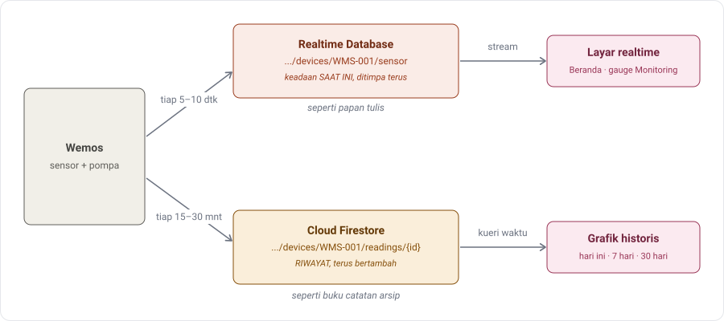
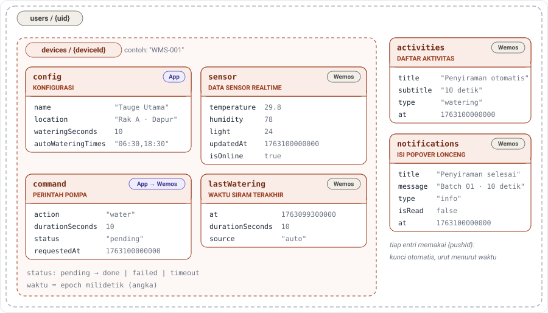
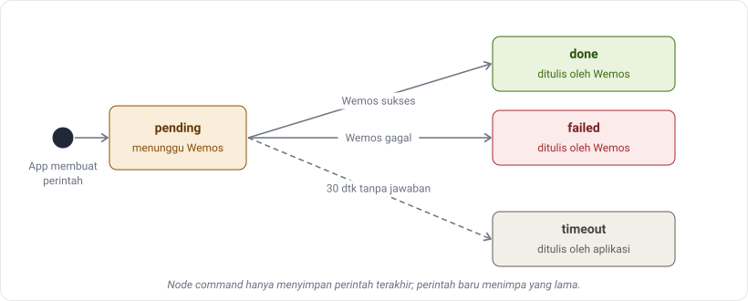
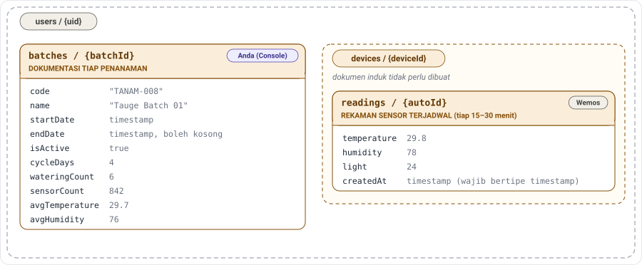

# 03 — Firebase & Database

TaugeKu memakai **dua database Firebase** dengan tugas yang berbeda, ditambah Authentication.
Dokumen ini menjelaskan pembagiannya, struktur datanya, aturan keamanan, dan hal-hal yang perlu diwaspadai.

## Daftar isi
1. [Layanan Firebase yang dipakai](#1-layanan-firebase-yang-dipakai)
2. [Pembagian tugas: RTDB vs Firestore](#2-pembagian-tugas-rtdb-vs-firestore)
3. [Struktur Realtime Database](#3-struktur-realtime-database)
4. [Struktur Cloud Firestore](#4-struktur-cloud-firestore)
5. [Siapa menulis apa](#5-siapa-menulis-apa)
6. [Aturan keamanan](#6-aturan-keamanan)
7. [Index dan kueri](#7-index-dan-kueri)
8. [Mode offline](#8-mode-offline)
9. [Biaya dan kuota](#9-biaya-dan-kuota)
10. [Catatan penting & keterbatasan](#10-catatan-penting--keterbatasan)
11. [Ide pengembangan lanjutan](#11-ide-pengembangan-lanjutan)

---

## 1. Layanan Firebase yang dipakai

| Layanan | Dipakai untuk | File Flutter |
|---|---|---|
| **Firebase Authentication** | Login email/password. Nama, email, dan tanggal bergabung di Profil diambil dari akun ini | `services/auth_service.dart` |
| **Realtime Database (RTDB)** | Konfigurasi, perintah pompa, data sensor realtime, waktu siram terakhir (+ daftar aktivitas & notifikasi) | `services/rtdb_paths.dart`, `device_service.dart`, `watering_service.dart`, `activity_service.dart`, `notification_service.dart` |
| **Cloud Firestore** | Dokumentasi tiap penanaman (batch) dan rekaman sensor terjadwal untuk grafik historis | `services/firestore_paths.dart`, `batch_service.dart`, `sensor_service.dart` |

**Tidak dipakai:** Cloud Storage (lihat bagian 9: layanan ini mensyaratkan paket berbayar). Foto profil hanya disimpan
sementara di memori aplikasi dan hilang saat logout atau aplikasi ditutup.

---

## 2. Pembagian tugas: RTDB vs Firestore

| | **Realtime Database** | **Cloud Firestore** |
|---|---|---|
| Sifat data | **Keadaan saat ini** — terus ditimpa | **Catatan sejarah** — terus bertambah |
| Contoh | Suhu sekarang, perintah siram, kapan terakhir siram | Rekaman suhu tiap 30 menit, catatan satu siklus tanam |
| Kecepatan | Sangat cepat, cocok untuk update tiap beberapa detik | Cocok untuk kueri ("data 7 hari terakhir") |
| Analogi | **Papan tulis** di kelas: ditulis ulang terus | **Buku catatan arsip**: ditambah halaman baru |
| Dibaca layar | Beranda, Monitoring (gauge), Perangkat, Notifikasi | Riwayat, grafik Monitoring, daftar "Data sensor" |

Aturan praktis: *"Apakah yang penting nilai **sekarang**, atau **perkembangannya**?"*
Sekarang → RTDB. Perkembangan/riwayat → Firestore.



<details>
<summary>Versi teks (untuk disalin)</summary>

```
                 tiap 5–10 detik                      tiap 15–30 menit
 Wemos ──────► RTDB  users/{uid}/devices/WMS-001/sensor        Wemos ──────► Firestore .../readings/{id}
                 │                                                                │
                 ▼ (stream realtime)                                              ▼ (kueri rentang waktu)
        Beranda, gauge Monitoring                                         Grafik "Hari ini / 7 / 30 hari"
```

</details>

---

## 3. Struktur Realtime Database

RTDB menyimpan satu pohon JSON. Alamat tiap node dikumpulkan di `lib/services/rtdb_paths.dart`.



<details>
<summary>Versi teks (untuk disalin)</summary>

```
users
└── {uid}
    ├── devices
    │   └── {deviceId}            mis. "WMS-001"
    │       ├── config            ← KONFIGURASI
    │       │     name: "Tauge Utama"
    │       │     location: "Rak A · Dapur"
    │       │     wateringSeconds: 10
    │       │     autoWateringTimes: "06:30,18:30"
    │       ├── sensor            ← DATA SENSOR REALTIME
    │       │     temperature: 29.8
    │       │     humidity: 78
    │       │     light: 24
    │       │     updatedAt: 1763100000000      (epoch milidetik)
    │       │     isOnline: true
    │       ├── command           ← PERINTAH POMPA
    │       │     action: "water"
    │       │     durationSeconds: 10
    │       │     status: "pending"             (pending → done | failed | timeout)
    │       │     requestedAt: 1763100000000
    │       └── lastWatering      ← WAKTU SIRAM TERAKHIR
    │             at: 1763099300000
    │             durationSeconds: 10
    │             source: "auto"                ("auto" | "manual")
    ├── activities
    │   └── {pushId}              title, subtitle, type, at
    └── notifications
        └── {pushId}              title, message, type, isRead, at
```

</details>

### 3.1 `config` — konfigurasi perangkat
| Field | Tipe | Contoh | Dipakai oleh |
|---|---|---|---|
| `name` | string | `"Tauge Utama"` | Aplikasi (form perangkat) |
| `location` | string | `"Rak A · Dapur"` | Aplikasi (form perangkat) |
| `wateringSeconds` | number | `10` | Aplikasi (lama siram yang dikirim di perintah & pesan toast) dan Wemos |
| `autoWateringTimes` | string | `"06:30,18:30"` | Aplikasi (teks "Berikutnya") dan Wemos (jadwal sebenarnya) |

Aplikasi **membuat** `config` saat perangkat ditambah (nilai bawaan 10 detik dan jadwal 06:30/18:30).
Belum ada layar untuk mengubah `wateringSeconds` / `autoWateringTimes` (tidak ada di desain); ubah lewat
Firebase Console, dan Wemos sebaiknya membaca nilai yang sama.

### 3.2 `sensor` — data realtime
| Field | Tipe | Satuan |
|---|---|---|
| `temperature` | number | °C |
| `humidity` | number | % |
| `light` | number | % |
| `updatedAt` | number | epoch **milidetik** (dipakai untuk "Sinkron · 18.42" dan "UPDATE 1 mnt") |
| `isOnline` | bool | |

`isOnline` juga ditulis form perangkat (pilihan Online/Offline pada desain). Wemos sebaiknya menulis `true`
setiap kali mengirim data.

### 3.3 `command` — perintah pompa
Satu node saja, berisi **perintah terakhir** (perintah baru menimpa yang lama):



<details>
<summary>Versi teks (untuk disalin)</summary>

```
App membuat → pending ──Wemos sukses──► done
                  │ ────Wemos gagal───► failed
                  └─ 30 dtk tanpa jawaban ─► timeout (ditulis oleh App)
```

</details>

### 3.4 `lastWatering` — siram terakhir
Diisi **Wemos** setelah pompa selesai. Aplikasi menampilkannya sebagai "Terakhir · 18.30".

### 3.5 `activities` dan `notifications`
Daftar kecil berisi kejadian dari perangkat. Kuncinya adalah *push id* Firebase (urut menurut waktu), sehingga
aplikasi cukup mengambil 10 / 20 terakhir tanpa index khusus.

| `activities` | Nilai |
|---|---|
| `title` | `"Penyiraman otomatis"` |
| `subtitle` | `"10 detik"` |
| `type` | `"watering"` \| `"saved"` \| `"light"` (menentukan ikon & warna) |
| `at` | epoch ms |

| `notifications` | Nilai |
|---|---|
| `title` / `message` | `"Penyiraman selesai"` / `"Batch 01 · 10 detik"` |
| `type` | `"info"` \| `"warning"` |
| `isRead` | `false` |
| `at` | epoch ms |

> **Keputusan desain:** daftar permintaan awal tidak menyebut aktivitas & notifikasi. Keduanya ditaruh di RTDB karena
> berasal dari kejadian realtime di perangkat dan berukuran kecil. Jika ingin memindahkannya ke Firestore, ubah
> `activity_service.dart` dan `notification_service.dart` (lapisan lain tidak terpengaruh).

---

## 4. Struktur Cloud Firestore



<details>
<summary>Versi teks (untuk disalin)</summary>

```
users (koleksi)
└── {uid}
    ├── batches (koleksi)                     ← DOKUMENTASI TIAP PENANAMAN
    │   └── {batchId}   mis. "TANAM-008"
    └── devices
        └── {deviceId}  mis. "WMS-001"        (dokumen induk tidak perlu dibuat)
            └── readings (koleksi)            ← REKAMAN SENSOR TERJADWAL
                └── {autoId}
```

</details>

Alamat koleksi ada di `lib/services/firestore_paths.dart`.

> Dokumen `devices/{deviceId}` di Firestore tidak perlu ada; Firestore mengizinkan sub-koleksi di bawah dokumen
> "kosong". Di Console, dokumen induk itu tampil miring (artinya *tidak benar-benar ada*). Itu normal.

### 4.1 `users/{uid}/batches/{batchId}` — dokumentasi penanaman
| Field | Tipe | Contoh | Keterangan |
|---|---|---|---|
| `code` | string | `"TANAM-008"` | |
| `name` | string | `"Tauge Batch 01"` | |
| `startDate` | timestamp | | **Wajib** (dipakai `orderBy`) |
| `endDate` | timestamp? | | Kosong jika masih berjalan |
| `isActive` | bool | `true` | `true` → tab "Aktif" dan kartu hero Beranda |
| `cycleDays` | number | `4` | Lama siklus |
| `wateringCount` | number | `6` | Jumlah penyiraman |
| `sensorCount` | number | `842` | Jumlah data sensor |
| `avgTemperature` | number? | `29.7` | Untuk batch selesai |
| `avgHumidity` | number? | `76` | Untuk batch selesai |

Saat ini batch dibuat/diubah lewat Firebase Console (atau tombol data contoh). Layar "tambah batch" tidak ada di desain.
Angka rekap (`wateringCount`, `sensorCount`, rata-rata) belum dihitung otomatis; lihat bagian 10.

### 4.2 `users/{uid}/devices/{deviceId}/readings/{autoId}` — rekaman sensor terjadwal
| Field | Tipe | Satuan |
|---|---|---|
| `temperature` | number | °C |
| `humidity` | number | % |
| `light` | number | % |
| `createdAt` | **timestamp** | waktu pengukuran |

Ditulis **Wemos pada interval tetap** (disarankan tiap 15–30 menit), terpisah dari kiriman realtime ke RTDB.
Aplikasi membaca data ini untuk grafik Monitoring dan daftar "Data sensor".

---

## 5. Siapa menulis apa

**App** = aplikasi Flutter, **IoT** = Wemos, **Anda** = lewat Firebase Console.

| Data | Lokasi | Penulis |
|---|---|---|
| `config/name`, `config/location` | RTDB | App (form perangkat) |
| `config/wateringSeconds`, `autoWateringTimes` | RTDB | App (nilai awal) → Anda / IoT |
| `sensor/*` | RTDB | **IoT** (kecuali `isOnline` juga dari form) |
| `command/*` | RTDB | App menulis `pending`; **IoT** menulis `done`/`failed`; App menulis `timeout` |
| `lastWatering/*` | RTDB | **IoT** |
| `activities`, `notifications` | RTDB | **IoT** (App hanya menandai `isRead`) |
| `batches/*` | Firestore | **Anda** (Console) |
| `readings/*` | Firestore | **IoT** |

---

## 6. Aturan keamanan

Berkas: [`database.rules.json`](../database.rules.json) (RTDB) dan [`firestore.rules`](../firestore.rules) (Firestore).
Terapkan lewat Console (tab **Rules** masing-masing) atau perintah:

```bash
firebase deploy --only database,firestore
```

**RTDB:**
```json
{
  "rules": {
    ".read": false,
    ".write": false,
    "users": {
      "$uid": {
        ".read":  "auth != null && auth.uid === $uid",
        ".write": "auth != null && auth.uid === $uid"
      }
    }
  }
}
```

**Firestore:**
```
match /users/{userId}/{document=**} {
  allow read, write: if request.auth != null && request.auth.uid == userId;
}
```

Artinya: **hanya pemilik akun** yang boleh membaca/menulis datanya sendiri; selain itu ditolak.

> **Peringatan:** jangan pernah memakai aturan "buka untuk semua" (`".read": true` atau `allow ... if true`) pada
> project sungguhan. Itu membuka seluruh database untuk siapa pun di internet.

**Untuk Wemos:** karena hanya pemilik `uid` yang boleh menulis, Wemos harus login sebagai pemilik yang sama
(lihat dokumen 06, bagian Keamanan).

---

## 7. Index dan kueri

| Database | Kueri | Lokasi kode | Index? |
|---|---|---|---|
| RTDB | semua `devices` (stream) | `DeviceService.watchDevices` | Tidak |
| RTDB | `activities` `orderByKey().limitToLast(10)` | `ActivityService` | Tidak (kunci push berurutan) |
| RTDB | `notifications` `orderByKey().limitToLast(20)` | `NotificationService` | Tidak |
| Firestore | `readings` dengan `createdAt >= X`, urut `createdAt desc`, `limit 500` | `SensorService.watchReadings` | Otomatis (satu field) |
| Firestore | `batches` urut `startDate desc` | `BatchService.watchBatches` | Otomatis (satu field) |

Jika Anda menambah kueri Firestore yang menggabungkan beberapa field, Firestore menampilkan pesan error beserta
**tautan** untuk membuat index — cukup klik tautan itu.

> **Syarat kunci push:** `activities` dan `notifications` harus dibuat dengan **push id** (di REST: `POST`; di library:
> `push()`), bukan kunci buatan sendiri, agar urutannya sesuai waktu.

---

## 8. Mode offline

* **Firestore** menyimpan cache lokal otomatis di Android/iOS: data yang pernah dibuka tetap tampil walau offline.
* **RTDB** pada konfigurasi bawaan **tidak** menyimpan cache untuk dibaca saat aplikasi dimulai ulang tanpa internet.
  Jika offline saat aplikasi dibuka, data perangkat baru muncul setelah koneksi tersambung.
* Label **"Firebase • Online/Offline"** di halaman Perangkat mengikuti status sambungan RTDB yang sebenarnya.
* **Tombol Siram ditolak saat offline** ("Tidak ada koneksi internet"). Ini disengaja: perintah yang ditulis saat offline
  akan diantrekan dan terkirim belakangan, sehingga pompa bisa menyala tiba-tiba.

---

## 9. Biaya dan kuota

> Informasi di bagian ini berasal dari halaman harga Firebase yang diperiksa pada November 2026.
> **Cek ulang di https://firebase.google.com/pricing** karena dapat berubah.

| Layanan | Paket gratis (Spark) |
|---|---|
| Authentication, Realtime Database, Cloud Firestore | Tersedia tanpa metode pembayaran, dengan batas pemakaian |
| **Cloud Storage for Firebase** | **Memerlukan paket Blaze (berbayar)** |

Karena itu aplikasi ini **tidak memakai Cloud Storage**. Foto profil bersifat lokal dan sementara.

Batas gratis yang tercantum pada halaman harga (ringkas):

| | Realtime Database | Cloud Firestore |
|---|---|---|
| Penyimpanan | 1 GB | 1 GiB |
| Transfer keluar | ±10 GB/bulan | 10 GiB/bulan |
| Hal lain | 100 koneksi bersamaan | 50 ribu pembacaan/hari |

Hal yang paling memengaruhi pemakaian pada aplikasi ini:

| Pemicu | Dampak | Saran |
|---|---|---|
| `readings` Firestore terlalu sering | Banyak **tulis** dan **baca** | Interval **15–30 menit**, bukan tiap menit |
| Grafik 30 hari | Banyak **baca** Firestore | Sudah dibatasi `limit(500)` dan diringkas jadi 8 titik |
| `sensor` RTDB terlalu sering | Transfer ke aplikasi | 5–10 detik cukup; hanya perubahan yang dikirim ke aplikasi |
| Listener aktif terus | Transfer | Listener dibatalkan saat logout |

> Pembacaan Firestore dihitung per dokumen. Satu kali membuka grafik "30 hari" bisa membaca hingga 500 dokumen.
> Pantau pemakaian di Firebase Console → Usage.

---

## 10. Catatan penting & keterbatasan

1. **Menghapus perangkat** menghapus node RTDB-nya (config, sensor, command, lastWatering), tetapi **`readings` di Firestore
   tidak ikut terhapus** (Firestore tidak menghapus sub-koleksi otomatis). Datanya tetap sebagai arsip; hapus lewat Console bila perlu.
2. **Status Online/Offline** bersifat "apa yang terakhir ditulis" (form atau Wemos). Belum ada deteksi otomatis berdasarkan
   `updatedAt` yang basi (ide pengembangan).
3. **Grafik 7/30 hari** memuat maksimal 500 rekaman terbaru; jika interval sangat rapat, rentang yang tampil bisa lebih pendek.
4. **Rekap batch** (`wateringCount`, `sensorCount`, rata-rata suhu) belum dihitung otomatis. Isi lewat Console atau tambahkan
   logika sendiri (Cloud Functions memerlukan Blaze, jadi alternatifnya aplikasi/skrip yang menghitung saat batch diselesaikan).
5. **Jadwal siram otomatis** hanya teks pada aplikasi (dari `config/autoWateringTimes`); yang menjalankannya adalah program Wemos.
6. **Beberapa perangkat:** aplikasi menampilkan satu "perangkat utama" (online pertama, atau perangkat pertama).
7. **Foto profil** tidak tersimpan: hilang saat logout/aplikasi ditutup (sengaja).
8. **Perintah siram lama:** node `command` menyimpan perintah terakhir. Wemos wajib mengabaikan perintah yang sudah lama
   (lihat dokumen 06).

---

## 11. Ide pengembangan lanjutan

| Ide | Catatan |
|---|---|
| Deteksi offline otomatis | Anggap perangkat offline bila `sensor/updatedAt` lebih tua dari N menit |
| Layar pengaturan (durasi siram, jadwal, rentang ideal) | Tulis ke `config`; Wemos membaca |
| Layar tambah/akhiri batch | Hitung `wateringCount` dan rata-rata saat batch diakhiri |
| Notifikasi push | Cloud Messaging; pemicu otomatis dari server biasanya memerlukan Cloud Functions (Blaze) |
| Keamanan perangkat IoT yang lebih baik | Akun khusus perangkat + perluasan aturan keamanan |
| Persistensi RTDB offline | `FirebaseDatabase.instance.setPersistenceEnabled(true)` (periksa dokumentasi resmi) |
