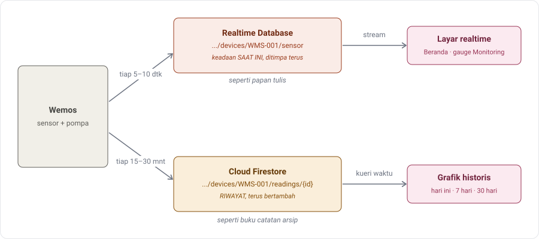
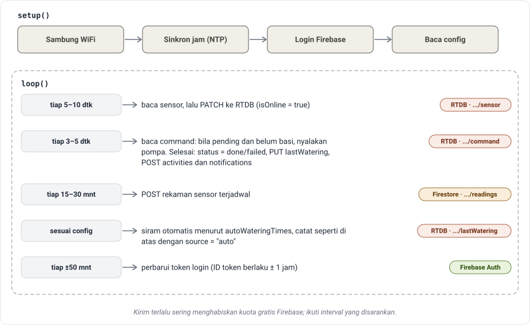

# 06 — Integrasi IoT (Wemos D1 Mini)

Dokumen ini adalah **kontrak data** antara aplikasi dan perangkat keras. Program Wemos (Arduino/C++)
harus mengikuti format di sini agar aplikasi menampilkan data dengan benar.

> **Batasan:** aplikasi Flutter ini tidak berisi kode program Wemos. Dokumen ini menjelaskan *apa* yang harus
> dikirim/dibaca, bukan sketch Arduino lengkap. Contoh permintaan HTTP di bawah adalah format standar REST
> Firebase dan **belum diuji pada perangkat Anda**.

## Daftar isi
1. [Gambaran: dua jalur data](#1-gambaran-dua-jalur-data)
2. [Cara Wemos mengakses Firebase](#2-cara-wemos-mengakses-firebase)
3. [Jalur A — Realtime Database](#3-jalur-a--realtime-database)
4. [Jalur B — Firestore (rekaman terjadwal)](#4-jalur-b--firestore-rekaman-terjadwal)
5. [Alur program Wemos (ringkas)](#5-alur-program-wemos-ringkas)
6. [Contoh format REST](#6-contoh-format-rest)
7. [Rekomendasi frekuensi](#7-rekomendasi-frekuensi)
8. [Catatan keamanan](#8-catatan-keamanan)
9. [Daftar periksa](#9-daftar-periksa)

---

## 1. Gambaran: dua jalur data

| Jalur | Database | Isi | Frekuensi |
|---|---|---|---|
| **A** | Realtime Database | sensor realtime, status perintah pompa, `lastWatering`, aktivitas, notifikasi, membaca `config` | tiap 5–10 detik (sensor); perintah dicek tiap 3–5 detik |
| **B** | Cloud Firestore | rekaman sensor terjadwal (`readings`) | tiap **15–30 menit** |

`{uid}` = ID akun pemilik (Firebase Console → Authentication → kolom *User UID*).
`{deviceId}` harus **sama persis** dengan ID di aplikasi, mis. `WMS-001`.
Semua waktu di RTDB berupa **epoch milidetik** (angka).



---

## 2. Cara Wemos mengakses Firebase

| Pendekatan | Keterangan |
|---|---|
| **Library Arduino untuk Firebase** (mis. *Firebase ESP Client* oleh Mobizt) | Paling mudah; mendukung Auth, RTDB, dan Firestore. Periksa dukungan ESP8266 pada versi terbaru library. |
| **REST API** lewat HTTPS | Tanpa library khusus; format JSON seperti bagian 6. Anda mengelola token login sendiri. |

Apa pun pilihannya, Wemos perlu: (1) terhubung WiFi, (2) **login** ke Firebase Authentication untuk mendapat token,
(3) sinkron jam lewat **NTP** (untuk `createdAt` Firestore dan stempel waktu).

---

## 3. Jalur A — Realtime Database

Semua di bawah `users/{uid}/devices/{deviceId}/`.

### 3.1 Kirim data sensor → `sensor`
Perbarui (*merge/PATCH*, jangan menimpa seluruh node perangkat):

| Field | Tipe | Satuan |
|---|---|---|
| `temperature` | number | °C |
| `humidity` | number | % (0–100) |
| `light` | number | % (0–100) |
| `updatedAt` | number | epoch **milidetik** (atau pakai nilai server `{".sv": "timestamp"}`) |
| `isOnline` | bool | `true` |

### 3.2 Baca konfigurasi ← `config`
Baca saat menyala (dan berkala) agar perilaku Wemos sesuai pengaturan:

| Field | Arti |
|---|---|
| `wateringSeconds` | lama pompa menyala untuk penyiraman |
| `autoWateringTimes` | jadwal siram otomatis, teks `"06:30,18:30"` (JJ:MM dipisah koma) |

`name` dan `location` hanya untuk tampilan aplikasi.
Aplikasi tidak menulis ke `config` setelah perangkat dibuat (selain `name`/`location` lewat form Edit).

### 3.3 Terima perintah siram ← `command`
Aplikasi menulis (menimpa) node `command`:

```json
{ "action": "water", "durationSeconds": 10, "status": "pending", "requestedAt": 1763100000000 }
```

Langkah Wemos:
1. Pantau `command/status` (stream, atau polling tiap 3–5 detik).
2. Jika `status == "pending"` dan `action == "water"`: **periksa umur perintah** — abaikan jika
   `requestedAt` lebih tua dari ±1 menit (mencegah siram karena perintah basi).
3. Nyalakan pompa selama `durationSeconds`.
4. Tulis `status = "done"` bila berhasil, atau `"failed"` bila gagal.

Aplikasi menunggu maksimal **30 detik** (`AppConstants.wateringTimeoutSeconds`). Jika belum dijawab, aplikasi menulis
`status = "timeout"`. Jadi **jangan menyalakan pompa untuk perintah yang statusnya sudah `timeout`** — periksa lagi
`status` tepat sebelum menyalakan pompa.

### 3.4 Catat siram terakhir → `lastWatering`
Setelah pompa berhenti (baik otomatis maupun manual):

```json
{ "at": 1763100012000, "durationSeconds": 10, "source": "manual" }
```
`source`: `"manual"` (dari perintah aplikasi) atau `"auto"` (jadwal).

### 3.5 Catat aktivitas & notifikasi (opsional tetapi disarankan)
Buat **entri baru dengan push id** (REST: `POST`; library: `push`):

`users/{uid}/activities`
```json
{ "title": "Penyiraman manual", "subtitle": "10 detik", "type": "watering", "at": 1763100012000 }
```
`users/{uid}/notifications`
```json
{ "title": "Penyiraman selesai", "message": "Batch 01 · 10 detik", "type": "info", "isRead": false, "at": 1763100012000 }
```
`type` aktivitas: `watering` | `saved` | `light`. `type` notifikasi: `info` | `warning`.
Aplikasi tidak mencatat aktivitas siram sendiri (agar tidak ganda dan tetap benar bila aplikasi ditutup).

---

## 4. Jalur B — Firestore (rekaman terjadwal)

Pada interval tetap (15–30 menit), buat **dokumen baru** (ID otomatis) di
`users/{uid}/devices/{deviceId}/readings`:

| Field | Tipe Firestore | Satuan |
|---|---|---|
| `temperature` | number (double) | °C |
| `humidity` | number | % |
| `light` | number | % |
| `createdAt` | **timestamp** | waktu pengukuran |

> `createdAt` **wajib bertipe timestamp** (bukan string/angka). Aplikasi memfilter dan mengurutkan berdasarkan field ini;
> dokumen tanpa `createdAt` tidak akan muncul di grafik.

Dokumen `batches` (dokumentasi penanaman) **tidak** ditulis Wemos; itu dikelola lewat Console/aplikasi.

---

## 5. Alur program Wemos (ringkas)



<details>
<summary>Versi teks (untuk disalin)</summary>

```
setup():
  sambung WiFi → sinkron jam (NTP) → login Firebase → baca config

loop():
  tiap 5–10 dtk : baca sensor → PATCH RTDB  .../sensor          (isOnline = true)
  tiap 3–5 dtk  : baca RTDB     .../command  → bila pending & belum basi → siram
                    └ selesai : command/status = done | failed
                              : PUT   .../lastWatering
                              : POST  .../activities , .../notifications
  tiap 15–30 mnt: POST Firestore .../readings   (rekaman terjadwal)
  jadwal otomatis (config/autoWateringTimes) : siram → catat seperti di atas dengan source = "auto"
  tiap ±50 mnt  : perbarui token login (ID token berlaku ±1 jam)
```

</details>

---

## 6. Contoh format REST

Ganti `PROJECT_ID`, `DB_URL`, `API_KEY`, `UID`, `ID_TOKEN`.
`DB_URL` adalah alamat Realtime Database Anda, mis. `https://PROJECT_ID-default-rtdb.REGION.firebasedatabase.app`
(lihat Firebase Console → Realtime Database).

### 6.1 Login (mendapat token)
```
POST https://identitytoolkit.googleapis.com/v1/accounts:signInWithPassword?key=API_KEY
Content-Type: application/json

{"email":"admin@taugeku.id","password":"...","returnSecureToken":true}
```
Respons berisi `idToken` (berlaku ± 1 jam) dan `refreshToken` untuk memperbaruinya.

### 6.2 RTDB — kirim sensor (PATCH = gabungkan field)
```
PATCH DB_URL/users/UID/devices/WMS-001/sensor.json?auth=ID_TOKEN
Content-Type: application/json

{"temperature":29.8,"humidity":78,"light":24,"isOnline":true,"updatedAt":{".sv":"timestamp"}}
```

### 6.3 RTDB — baca perintah siram
```
GET DB_URL/users/UID/devices/WMS-001/command.json?auth=ID_TOKEN
```

### 6.4 RTDB — jawab perintah
```
PATCH DB_URL/users/UID/devices/WMS-001/command.json?auth=ID_TOKEN
{"status":"done"}
```

### 6.5 RTDB — siram terakhir
```
PUT DB_URL/users/UID/devices/WMS-001/lastWatering.json?auth=ID_TOKEN
{"at":{".sv":"timestamp"},"durationSeconds":10,"source":"manual"}
```

### 6.6 RTDB — tambah aktivitas (POST membuat push id otomatis)
```
POST DB_URL/users/UID/activities.json?auth=ID_TOKEN
{"title":"Penyiraman manual","subtitle":"10 detik","type":"watering","at":{".sv":"timestamp"}}
```

### 6.7 Firestore — rekaman terjadwal
```
POST https://firestore.googleapis.com/v1/projects/PROJECT_ID/databases/(default)/documents/users/UID/devices/WMS-001/readings
Authorization: Bearer ID_TOKEN
Content-Type: application/json

{
  "fields": {
    "temperature": {"doubleValue": 29.8},
    "humidity":    {"doubleValue": 78},
    "light":       {"doubleValue": 24},
    "createdAt":   {"timestampValue": "2026-11-14T10:30:00Z"}
  }
}
```

---

## 7. Rekomendasi frekuensi

| Aksi | Saran | Alasan |
|---|---|---|
| Kirim `sensor` (RTDB) | 5–10 detik | Cukup "hidup"; hindari tiap <1 detik |
| Cek `command` | 3–5 detik (atau stream) | Responsif tanpa boros |
| Kirim `readings` (Firestore) | **15–30 menit** | Menghemat kuota baca/tulis Firestore |
| Perbarui token | sebelum 1 jam | Token kedaluwarsa |

---

## 8. Catatan keamanan

* Aturan database hanya mengizinkan **pemilik akun** menulis. Cara paling sederhana adalah Wemos login memakai akun
  pemilik yang sama. **Kelemahannya:** email & password pemilik tersimpan di firmware; siapa pun yang membongkar
  perangkat dapat mengambilnya.
* Untuk penggunaan serius, buat akun khusus perangkat dan perluas aturan keamanan (mis. *custom claims*). Ini di luar
  cakupan project ini.
* Jangan memasukkan password/kunci ke repositori publik.

---

## 9. Daftar periksa

- [ ] ID perangkat di Wemos = ID di aplikasi (`WMS-001`)
- [ ] Waktu RTDB berupa **angka epoch milidetik** (atau `{".sv":"timestamp"}`)
- [ ] Sensor diperbarui dengan **PATCH** (tidak menimpa `config`/`lastWatering`)
- [ ] Firestore `createdAt` bertipe **timestamp**
- [ ] `temperature`, `humidity`, `light` bertipe **number**
- [ ] Perintah siram: `pending` → `done`/`failed` dalam < 30 detik; perintah basi diabaikan
- [ ] `lastWatering` diisi setelah pompa berhenti
- [ ] `activities`/`notifications` dibuat dengan **push id** (POST)
- [ ] Jam perangkat tersinkron (NTP); token diperbarui berkala
- [ ] Frekuensi wajar (sensor 5–10 dtk, rekaman Firestore 15–30 mnt)
